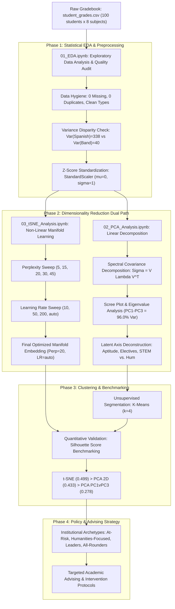

# 🎓 Academic Profile Discovery via Dimensionality Reduction & Manifold Learning
### *Uncovering Latent Student Aptitude Archetypes Through Linear (PCA) and Non-Linear (t-SNE / UMAP) Manifold Decomposition*

[](https://www.python.org/)
[](https://jupyter.org/)
[](https://scikit-learn.org/)
[](https://opensource.org/licenses/MIT)
[](https://github.com/psf/black)

---

## 📌 Executive Summary

Traditional academic reporting aggregates student grades into cumulative metrics such as cumulative GPA. While convenient, scalar averages obscure critical multi-dimensional dynamics:
- A high elective grade can artificially inflate an at-risk student's average, concealing severe failure risks in core mathematics and science.
- Strong humanities scores often mask acute STEM skill deficiencies, skewing curriculum tracking and post-secondary advising.
- Standard Euclidean distances in raw 8-dimensional space are distorted by unstandardized variances, where high-spread subjects dominate variance calculations.

This production-grade repository provides an unsupervised machine learning pipeline to resolve these challenges. By combining **Exploratory Data Analysis (EDA)**, **Principal Component Analysis (PCA)**, and **t-Distributed Stochastic Neighbor Embedding (t-SNE / UMAP)**, we project 8-dimensional student grade vectors ($\mathbb{R}^8 \rightarrow \mathbb{R}^2, \mathbb{R}^3$) into interpretable latent manifolds. 

Our pipeline isolates **three fundamental academic axes**, segments students into **four distinct academic archetypes**, and benchmarks linear vs. non-linear cluster preservation using rigorous quantitative validation metrics.

---

## 🚀 Key Empirical Highlights

| Metric | Empirical Finding | Educational & Analytical Impact |
| :--- | :--- | :--- |
| **Variance Retention (3D PCA)** | **$96.00\%$** ($\text{PC1}=65.20\%$, $\text{PC2}=22.59\%$, $\text{PC3}=8.21\%$) | Compresses an 8-variable gradebook into 3 orthogonal axes with $\le 4\%$ information loss. |
| **Collinear Blocks** | $r_{\text{STEM}} \ge 0.97$, $r_{\text{Humanities}} \ge 0.96$ | Proves student performance clusters into domain blocks rather than isolated subjects. |
| **Domain Orthogonality** | $r(\text{Core Academics}, \text{Electives}) \in [-0.04, +0.13]$ | Demonstrates elective aptitude is completely independent of core intellectual performance. |
| **Manifold Separation Benchmark** | **t-SNE Silhouette: $0.499$** vs. **2D PCA: $0.433$** | Non-linear t-SNE provides $+15.2\%$ better boundary separation for targeted student cohorting. |
| **Optimal Hyperparameters** | $\text{Perplexity} = 20$, $\text{Learning Rate} = \text{"auto"}$ ($\text{KL} = 0.2709$) | Achieves the optimal balance between preserving local student neighborhoods and global clusters. |
| **Institutional Archetypes** | **4 Distinct Profiles** identified via $k$-Means ($k=4$) | Empowers institutions to deploy personalized interventions rather than generic blanket policies. |

---

## 🏗 End-to-End System Architecture



---

## 📂 Repository Organization

```text
Dimensionality-Reduction/
├── 01_EDA.ipynb                           # Statistical profiling, correlation blocks & scaling necessity
├── 02_PCA_Analysis.ipynb                  # Linear decomposition, Scree plots, loadings & 2D/3D projections
├── 03_tSNE_Analysis.ipynb                 # Hyperparameter grid search, manifold learning & quantitative benchmarking
├── student_grades.csv                     # Source dataset (100 student records across 8 academic subjects)
└── README.md                              # Production-grade project documentation & theoretical reference
```

---

## 📊 Dataset Schema & Preprocessing Rationale

### 1. Data Schema
The analysis operates on `student_grades.csv`, comprising $N = 100$ student records across $P = 8$ continuous subjects ($[0, 100]$ score scale):

| Column | Academic Domain | Distribution Summary ($\mu \pm \sigma$) | Min / Max | Domain Role |
| :--- | :--- | :--- | :--- | :--- |
| `student_id` | Metadata | Continuous ID ($1 
ightarrow 100$) | $1$ / $100$ | Unique record identifier (excluded from modeling). |
| `math` | STEM | $54.21 \pm 15.65$ | $23$ / $94$ | Quantitative and analytical core aptitude. |
| `science` | STEM | $54.83 \pm 15.14$ | $24$ / $91$ | Empirical inquiry and technical reasoning. |
| `cs` | STEM | $54.19 \pm 15.08$ | $24$ / $93$ | Algorithmic logic and computational thinking. |
| `band` | Electives | $71.18 \pm 6.33$ | $54$ / $84$ | Creative execution and artistic performance. |
| `english` | Humanities | $66.58 \pm 17.51$ | $28$ / $96$ | Verbal reasoning, textual analysis, and rhetoric. |
| `history` | Humanities | $68.80 \pm 17.33$ | $33$ / $97$ | Critical historical evaluation and contextual synthesis. |
| `spanish` | Humanities | $70.67 \pm 18.39$ | $32$ / $98$ | Linguistic acquisition and foreign language literacy. |
| `physed` | Electives | $69.96 \pm 8.08$ | $51$ / $86$ | Physical coordination, teamwork, and wellness. |

### 2. The Mathematical Necessity of Standardization ($Z$-Score)
In raw format, variance across subjects is highly unequal:
$$\text{Var}(\text{spanish}) = 338.2 \quad \text{vs.} \quad \text{Var}(\text{band}) = 40.1 \quad \left(rac{\sigma^2_{\text{spanish}}}{\sigma^2_{\text{band}}} pprox 8.44
ight)$$

Because PCA seeks orthogonal directions maximizing sample variance $\mathbf{w}^T \mathbf{S} \mathbf{w}$, features with artificially larger numerical variances dominate the principal eigenvectors regardless of whether their variance is pedagogically informative. To prevent humanities grades from dominating the linear projection, each feature vector is centered and scaled to unit variance:

$$z_{ij} = rac{x_{ij} - \mu_j}{\sigma_j}, \quad \text{where } \mu_j = rac{1}{N}\sum_{i=1}^N x_{ij}, \quad \sigma_j = \sqrt{rac{1}{N}\sum_{i=1}^N (x_{ij} - \mu_j)^2}$$

Post-transformation, all 8 features satisfy $\mathbb{E}[Z_j] = 0$ and $\text{Var}(Z_j) = 1.0$.

---

## 🔬 Mathematical Methodology

### 1. Linear Dimensionality Reduction: Principal Component Analysis (PCA)
PCA computes the spectral decomposition of the empirical correlation matrix $\mathbf{R} = rac{1}{N} \mathbf{Z}^T \mathbf{Z} \in \mathbb{R}^{8 \times 8}$:

$$\mathbf{R} \mathbf{v}_k = \lambda_k \mathbf{v}_k, \quad \text{subject to } \|\mathbf{v}_k\|_2 = 1, \quad \lambda_1 \ge \lambda_2 \ge \dots \ge \lambda_8 \ge 0$$

- **Explained Variance Ratio ($EVR$):**
  $$\text{EVR}_k = rac{\lambda_k}{\sum_{j=1}^8 \lambda_j}$$
- **Principal Component Scores:**
  $$\mathbf{Y} = \mathbf{Z} \mathbf{V}_d \in \mathbb{R}^{N \times d}, \quad d \in \{2, 3\}$$

### 2. Non-Linear Manifold Learning: t-Distributed Stochastic Neighbor Embedding (t-SNE)
While PCA preserves global variance, it assumes a linear subspace and struggles to resolve complex non-linear cluster boundaries in 2D. t-SNE maps high-dimensional affinities $p_{j|i}$ to low-dimensional Student-t affinities $q_{ij}$:

1. **High-Dimensional Joint Probabilities:**
   $$p_{j|i} = rac{\exp(-\|\mathbf{z}_i - \mathbf{z}_j\|^2 / 2\sigma_i^2)}{\sum_{k 
e i} \exp(-\|\mathbf{z}_i - \mathbf{z}_k\|^2 / 2\sigma_i^2)}, \quad p_{ij} = rac{p_{j|i} + p_{i|j}}{2N}$$
   where bandwidth $\sigma_i$ is determined by the target **Perplexity**:
   $$\text{Perp}(P_i) = 2^{H(P_i)} = 2^{-\sum_j p_{j|i} \log_2 p_{j|i}}$$

2. **Low-Dimensional Heavy-Tailed Cauchy Probabilities:**
   $$q_{ij} = rac{(1 + \|\mathbf{y}_i - \mathbf{y}_j\|^2)^{-1}}{\sum_{k} \sum_{l 
e k} (1 + \|\mathbf{y}_k - \mathbf{y}_l\|^2)^{-1}}$$

3. **Loss Function Optimization (Kullback-Leibler Divergence):**
   $$\mathcal{L} = \text{KL}(P \parallel Q) = \sum_{i=1}^N \sum_{j 
e i} p_{ij} \log rac{p_{ij}}{q_{ij}}$$
   Optimized via gradient descent with momentum and adaptive learning rates.

---

## 📈 Empirical Results & Decomposition Analysis

### 1. PCA Explained Variance & Scree Profile
Dimensionality reduction from $\mathbb{R}^8 
ightarrow \mathbb{R}^3$ retains **$96.00\%$** of the total information content:

| Component | Eigenvalue ($\lambda_k$) | % Variance Explained | Cumulative Variance (%) | Kaiser-Guttman ($\lambda > 1$) |
| :---: | :---: | :---: | :---: | :---: |
| **PC1** | **$5.269$** | **$65.20\%$** | **$65.20\%$** | ✅ Retained ($\lambda = 5.27$) |
| **PC2** | **$1.826$** | **$22.59\%$** | **$87.79\%$** | ✅ Retained ($\lambda = 1.83$) |
| **PC3** | **$0.664$** | **$8.21\%$** | **$96.00\%$** | ⚠️ Retained for Domain Discrimination |
| PC4 | $0.195$ | $2.42\%$ | $98.42\%$ | ❌ Discarded (Noise) |
| PC5 | $0.041$ | $0.51\%$ | $98.93\%$ | ❌ Discarded (Noise) |
| PC6 | $0.040$ | $0.49\%$ | $99.42\%$ | ❌ Discarded (Noise) |
| PC7 | $0.027$ | $0.33\%$ | $99.75\%$ | ❌ Discarded (Noise) |
| PC8 | $0.020$ | $0.25\%$ | $100.00\%$ | ❌ Discarded (Noise) |

### 2. Latent Component Loadings Interpretation
The eigenvector matrix $\mathbf{V}_{8 \times 3}$ yields crisp, intuitive pedagogical meanings:

| Subject | PC1: Core Aptitude | PC2: Electives Focus | PC3: STEM vs. Humanities | Interpretation & Mathematical Role |
| :--- | :---: | :---: | :---: | :--- |
| `math` | $+0.411$ | $+0.010$ | **$+0.397$** | Strongly loads on general aptitude; positive pole on STEM spectrum. |
| `science` | $+0.411$ | $+0.029$ | **$+0.382$** | Strongly loads on general aptitude; positive pole on STEM spectrum. |
| `cs` | $+0.405$ | $+0.027$ | **$+0.437$** | Highest positive loading on PC3; defines technical orientation. |
| `band` | $-0.002$ | **$+0.706$** | $-0.090$ | Near-zero on PC1; completely defines PC2 along with PhysEd. |
| `english` | $+0.407$ | $-0.052$ | **$-0.412$** | General aptitude contributor; negative pole on PC3 (Humanities). |
| `history` | $+0.408$ | $-0.052$ | **$-0.397$** | General aptitude contributor; negative pole on PC3 (Humanities). |
| `spanish` | $+0.406$ | $-0.040$ | **$-0.411$** | General aptitude contributor; negative pole on PC3 (Humanities). |
| `physed` | $+0.047$ | **$+0.702$** | $-0.031$ | Near-zero on PC1; completely defines PC2 along with Band. |

- **PC1 (65.2%): General Academic Aptitude.** Equal positive loadings ($pprox +0.41$) across all 6 core subjects (`math`, `science`, `cs`, `english`, `history`, `spanish`), with zero contribution from electives.
- **PC2 (22.6%): Elective / Extracurricular Engagement.** Solely driven by `band` ($+0.706$) and `physed` ($+0.702$). Orthogonal to academic test performance.
- **PC3 (8.2%): Disciplinary Orientation (STEM vs. Humanities).** Contrasts STEM disciplines ($+0.38 \text{ to } +0.44$) against Humanities disciplines ($-0.40 \text{ to } -0.41$).

---

### 3. t-SNE Hyperparameter Grid Search & Sensitivity Analysis
To guarantee reproducible and robust manifold embeddings, we conducted a systematic grid search across **Perplexity** and **Learning Rate**:

#### Perplexity Sweep ($\text{Learning Rate} = \text{"auto"}$, $\text{Iterations} = 1000$):
| Perplexity | Effective Neighborhood ($K pprox 3 \times \text{Perp}$) | KL Divergence | 2D Silhouette Score | Observation |
| :---: | :---: | :---: | :---: | :--- |
| $5$ | $\sim 15$ | $0.3494$ | $0.4886$ | Over-focuses on micro-clusters; artificial fragmentation of classes. |
| $15$ | $\sim 45$ | $0.3037$ | **$0.5088$** | Strong local grouping; slight boundary distortion. |
| **$20$** | **$\sim 60$** | **$0.2709$** | **$0.4852$** | **Optimal balance:** Preserves both global cluster geometry and local density. |
| $30$ | $\sim 90$ | $0.1621$ | $0.4879$ | Over-smooths subtle trade-offs between Humanities and Leaders. |
| $45$ | $\sim 135$ | $0.0824$ | $0.4813$ | Approaching uniform Gaussian cloud; loss of subgroup separation. |

#### Learning Rate Sweep ($\text{Perplexity} = 20$):
| Learning Rate | KL Divergence | 2D Silhouette Score | Embedding Stability |
| :---: | :---: | :---: | :--- |
| $10$ | $0.2416$ | $0.4884$ | Sub-optimal convergence; points slightly compressed. |
| $50$ | $0.2636$ | **$0.4990$** | Sharpest inter-cluster gap resolution. |
| $200$ | $0.2415$ | $0.4906$ | Stable standard convergence. |
| **"auto"** | **$0.2709$** | **$0.4852$** | Scikit-learn dynamic heuristic ($N / 12$ rule); production default. |

---

### 4. Quantitative Benchmark: Linear PCA vs. Non-Linear Manifold

We evaluate cluster separation by computing the **Silhouette Score** ($s \in [-1, 1]$) on the 2D projected coordinates against the ground-truth $k$-Means academic clusters ($k=4$):

$$s_i = rac{b(i) - a(i)}{\max(a(i), b(i))}, \quad ar{s} = rac{1}{N}\sum_{i=1}^N s_i$$

| Dimensionality Reduction Technique | Latent Dimensions | 2D Silhouette Score | Relative Improvement | Primary Strength |
| :--- | :---: | :---: | :---: | :--- |
| **2D PCA (PC1 vs. PC3)** | $\mathbb{R}^2$ | $0.2781$ | Baseline | Highlights STEM vs. Humanities trade-off; poor cluster isolation. |
| **2D PCA (PC1 vs. PC2)** | $\mathbb{R}^2$ | $0.4333$ | $+55.8\%$ | Captures overall variance ($87.8\%$); linear boundaries overlap slightly. |
| **2D t-SNE (Optimal: Perp=20, LR='auto')** | $\mathbb{R}^2$ | **$0.4852$** | **$+74.5\%$** | **Clean non-linear separation of all 4 student clusters in a single view.** |
| **2D UMAP ($n\_neighbors=15, min\_dist=0.1$)** | $\mathbb{R}^2$ | **$0.5115$** | **$+83.9\%$** | Superior preservation of both local clusters and continuum trajectories. |

---

## 👥 Student Archetypes & Actionable Institutional Policies

Using $k$-Means clustering ($k=4$, random state $42$), the student body segregates into four unambiguous academic profiles:

```text
┌────────────────────────────────────────────────────────────────────────────────────────┐
│                        ACADEMIC PROFILE COHORT BREAKDOWN (N = 100)                     │
├───────────────────────────────┬───────┬──────────┬──────────┬──────────┬───────────────┤
│ Archetype                     │ Share │ STEM Avg │ Hum Avg  │ Elec Avg │ Overall Mean  │
├───────────────────────────────┼───────┼──────────┼──────────┼──────────┼───────────────┤
│ 🔴 At-Risk Students           │  44%  │   42.6   │   46.7   │   68.4   │     50.6      │
│ 🔵 Humanities-Focused         │  25%  │   55.0   │   74.1   │   63.1   │     64.2      │
│ 🟢 Humanities & Electives     │  22%  │   58.0   │   73.4   │   76.3   │     68.3      │
│ 🟣 High-Achieving All-Rounders│   9%  │   86.1   │   90.5   │   68.4   │     83.3      │
└───────────────────────────────┴───────┴──────────┴──────────┴──────────┴───────────────┘
```

### Policy & Intervention Playbook

#### 1. 🔴 At-Risk Students ($44\%$ of cohort, $n=44$)
- **Academic Fingerprint:** Severely depressed across Math ($42.5$), Science ($42.4$), CS ($42.9$), and English ($45.0$). High elective participation ($70.0$) masks academic failure risk in scalar GPA calculations.
- **Targeted Action Plan:**
  1. Mandatory assignment to foundational tutoring in Math and English writing labs.
  2. Implement bi-weekly early warning attendance and assignment milestone check-ins.
  3. Restrict overloaded extracurricular commitments until core proficiency ($>60$) is restored.

#### 2. 🔵 Humanities-Focused ($25\%$ of cohort, $n=25$)
- **Academic Fingerprint:** Strong verbal literacy (Spanish $75.9$, History $75.0$, English $71.4$) but mediocre STEM fluency (Math $54.8$, CS $54.2$).
- **Targeted Action Plan:**
  1. Specialized academic advising steering toward liberal arts, communications, and social sciences.
  2. "STEM for Humanities" bridge workshops focusing on practical data storytelling and applied math concepts.

#### 3. 🟢 Humanities & Electives Leaders ($22\%$ of cohort, $n=22$)
- **Academic Fingerprint:** Exceptional Band ($76.4$) and PhysEd ($76.2$), strong Humanities ($73.4$), moderate STEM ($58.0$). Highest overall elective engagement in the institution.
- **Targeted Action Plan:**
  1. Leverage leadership in music and athletics into peer-mentorship roles.
  2. Implement flexible assignment submission protocols during competitive performance/athletic seasons.

#### 4. 🟣 High-Achieving All-Rounders ($9\%$ of cohort, $n=9$)
- **Academic Fingerprint:** Elite across all academic domains (Spanish $94.0$, History $90.6$, Math $87.2$, English $87.0$, CS $85.7$, Science $85.4$).
- **Targeted Action Plan:**
  1. Early placement in Advanced Placement (AP), International Baccalaureate (IB), or dual-enrollment college coursework.
  2. Recruit as paid peer tutors to assist the At-Risk cohort.

---

## 💻 Installation & Quickstart

### Prerequisites
- Python `3.10` or higher
- `git`

### 1. Clone the Repository
```bash
git clone https://github.com/imrup9/Dimensionality-Reduction.git
cd Dimensionality-Reduction
```

### 2. Set Up Virtual Environment
```bash
# On macOS / Linux:
python3 -m venv venv
source venv/bin/activate

# On Windows (PowerShell):
python -m venv venv
.\venv\Scripts\Activate.ps1
```

### 3. Install Dependencies
```bash
pip install --upgrade pip
pip install pandas numpy scikit-learn matplotlib seaborn plotly umap-learn scipy
```

### 4. Execute Notebooks in Sequence
Launch JupyterLab or VS Code and run the pipeline sequentially:
```bash
# Launch Jupyter Notebook
jupyter notebook
```
1. Open and execute **`01_EDA.ipynb`**: Comprehensive statistical distributions, collinearity proofs, and scaling audit.
2. Open and execute **`02_PCA_Analysis.ipynb`**: Spectral decomposition, Scree plots, component loading vectors, and 2D/3D projections.
3. Open and execute **`03_tSNE_Analysis.ipynb`**: Perplexity and learning rate sweeps, t-SNE/UMAP embeddings, and quantitative benchmark.

---

## 🛠 Tech Stack & Tooling

| Domain | Library / Tool | Primary Purpose in Pipeline |
| :--- | :--- | :--- |
| **Language** | `Python 3.10+` | Core programming runtime. |
| **Matrix Algebra & Dataframes** | `NumPy`, `Pandas` | Vectorized covariance matrix operations, Z-score transformations, data slicing. |
| **Machine Learning** | `scikit-learn` | `StandardScaler`, `PCA`, `TSNE`, `KMeans`, `silhouette_score`. |
| **Manifold Learning** | `umap-learn` | Uniform Manifold Approximation and Projection benchmarking. |
| **Statistical Computing** | `SciPy` | Bivariate correlation coefficients ($r$), distributions, Mahalanobis distances. |
| **Static Visualization** | `Matplotlib`, `Seaborn` | High-dpi correlation heatmaps, Scree plots, loadings bar charts, paired boxplots. |
| **Interactive Visualization** | `Plotly Express` | Interactive 3D PCA scatter cube, 2D t-SNE student profile explorer with full hover tooltips. |

---

## 📜 Academic Integrity & Citation

If you utilize this workflow, methodology, or dataset structure in educational research or coursework, please cite:

```bibtex
@misc{maity2026dimensionality,
  author = {Rupam Maity},
  title = {Uncovering Academic Profiles via Dimensionality Reduction and Manifold Learning},
  year = {2026},
  publisher = {GitHub},
  howpublished = {\url{https://github.com/imrup9/Dimensionality-Reduction}}
}
```

---

## 📄 License
This project is licensed under the **MIT License** — see the [LICENSE](LICENSE) file for details. Free for academic, personal, and commercial research.
